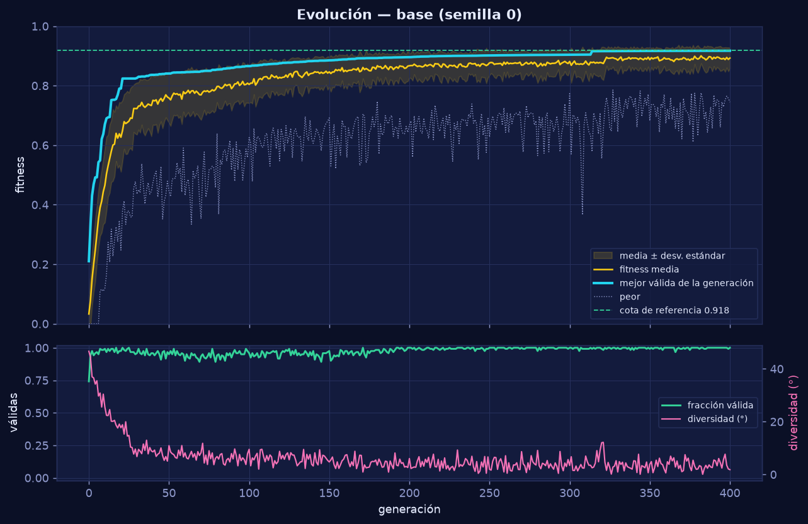

# 🛰️ AstroShield — Evolucionar una constelación inteligente

Algoritmo genético que diseña una constelación de **8 satélites** de observación para cubrir **6 regiones
prioritarias**, respetando **zonas de desechos espaciales** y **posiciones ocupadas**. Incluye pruebas, análisis
estadístico y un **centro de control** interactivo (globo 3D o mapa 2D, gráficas y todas las pruebas en una sola
pantalla) generado con los datos reales de cada ejecución.



## Resultado principal

| Métrica | Valor |
|---|---|
| Fitness de la solución de referencia | **0.9174** (99.94 % de la cota de referencia 0.9179) |
| Regiones cubiertas | **6/6**, con redundancia en las dos regiones Alta |
| Violaciones de restricciones | **0**, en 10/10 ejecuciones |
| 10 semillas | 0.9151 ± 0.0052, frente a 0.4232 de la búsqueda aleatoria (p = 8 × 10⁻⁵) |

## Ejecutar en Google Colab (recomendado)

1. Abre <https://colab.research.google.com> → **Archivo → Subir notebook** → elige `notebooks/AstroShield.ipynb`.
   Si el repositorio ya está en GitHub, también puedes usar **Archivo → Abrir notebook → GitHub** y pegar la URL.
2. **Entorno de ejecución → Ejecutar todo.** El centro de control aparece **al instante** con la ejecución de
   referencia, y la sección 4 lo actualiza con una ejecución nueva (≈ 4 min en modo completo, ≈ 1 min en modo rápido).

El notebook es **autocontenido**: sus primeras celdas recrean el paquete `astroshield`, las pruebas y los datos de
referencia con `%%writefile`, así que no hace falta subir ningún otro archivo ni instalar nada. Toda la información
(globo, gráficas, pruebas e interpretaciones) vive en **un solo centro de control**; el notebook solo tiene las celdas
que necesitan Python: instalación, configuración, centro de control, ejecución, laboratorio y descarga. Ya incluye las
salidas de una ejecución, así que también se puede revisar sin ejecutarlo.

### El centro de control

* **Vista Misión:** globo 3D (o mapa 2D con el interruptor de arriba a la derecha; 3D por defecto), regiones con su
  cobertura, telemetría de la evolución y tabla de satélites. La línea de tiempo recorre **cada mejora** del AG (▶ la
  reproduce) y *Comparar con inicial* une cada satélite con su posición de la generación 0.
* **Configuración en el mapa:** cualquier prueba (E1, cada semilla de E7, E4, E5, E6, E8, E9 y el laboratorio) se
  puede ver en el globo; las pestañas tienen botones **Ver en el mapa**.
* **Pestañas:** Evolución, Ejecuciones, Restricciones, Escenarios límite, Prueba propia, Calibración y Modelo y
  verificación. Cada prueba muestra **condiciones → resultado → interpretación**, calculados con los datos mostrados.
* **Verificación:** el navegador vuelve a calcular la cobertura de la solución dibujada sin usar los valores de Python
  y la compara con el resultado del AG.
* Pensado para Colab: datos compactos (< 1 MB), sin instalaciones, cambio automático a 2D si no hay WebGL y el globo
  se pausa cuando el panel no está a la vista. También se descarga como `centro_control.html`.

## Ejecutar localmente

```bash
python -m venv .venv && source .venv/bin/activate
pip install -r requirements.txt
python -m pytest                                    # pruebas unitarias
python herramientas/ejecutar_experimentos.py        # todas las pruebas E1–E10 → outputs/ (≈ 4 min)
open outputs/centro_control.html                    # centro de control
python herramientas/construir_notebook.py --ejecutar   # regenera el notebook desde el código fuente
```

Uso mínimo desde Python:

```python
from astroshield.escenario import escenario_base
from astroshield.algoritmo_genetico import ejecutar_ag, ParametrosAG
r = ejecutar_ag(escenario_base(), ParametrosAG(generaciones=400), semilla=0)
print(r.eval_mejor.fitness, r.eval_mejor.n_cubiertas)
print(r.eval_mejor.tabla_regiones())
```

## Estructura

```
astroshield/          paquete
  geometria.py                 geometría esférica
  escenario.py                 regiones, zonas, parámetros y cambios de condiciones
  evaluacion.py                modelo de cobertura, restricciones, fitness y criterios de aceptación
  algoritmo_genetico.py        algoritmo genético (cruce alineado, Deb + reparación, elitismo)
  referencias.py               búsqueda aleatoria y heurística voraz
  experimentos.py              pruebas E1–E10 y ejecutar_todo()
  visualizacion.py             figuras PNG estáticas para los documentos
  centro_control.py            datos y salida del centro de control
  plantilla_centro_control.py  página HTML del centro de control (globe.gl + d3)
pruebas/              pruebas unitarias (pytest)
herramientas/         ejecutar_experimentos.py, construir_notebook.py
notebooks/            AstroShield.ipynb (para Colab)
docs/                 entregables escritos
outputs/              evidencia: resultados.json, CSV, figuras, centro_control.html
```

## Entregables

| # | Entregable | Dónde |
|---|---|---|
| 1 | Definición del problema | [`docs/01_definicion_problema.md`](docs/01_definicion_problema.md) |
| 2 | Implementación funcional | [`astroshield/`](astroshield) y [`notebooks/AstroShield.ipynb`](notebooks/AstroShield.ipynb) |
| 3 | Pruebas y validación | [`docs/03_pruebas_validacion.md`](docs/03_pruebas_validacion.md), [`pruebas/`](pruebas) y las pestañas del centro de control |
| 4 | Análisis de resultados | [`docs/04_analisis_resultados.md`](docs/04_analisis_resultados.md) |
| 5 | Visualización 3D | [`outputs/centro_control.html`](outputs/centro_control.html) y la sección 3 del notebook |
| 6 | Repositorio y presentación | este README, el historial de commits y [`docs/06_guia_presentacion.md`](docs/06_guia_presentacion.md) |

## Paleta y diseño

Tema oscuro tipo "centro de control de misión" (tipografía monoespaciada, paneles con bordes de neón), aplicado igual en
el centro de control, las figuras y el globo:
cian `#22D3EE` para la constelación final, violeta `#A78BFA` para la inicial, verde `#34D399` para regiones cubiertas,
rojo `#F87171` para regiones no cubiertas o violaciones, naranja `#FB923C` para zonas de desechos y rosa `#F472B6` para
posiciones ocupadas.

## Uso de herramientas de inteligencia artificial

> **Completar por el equipo antes de entregar.**

Se usó un asistente de IA (Claude, de Anthropic) para: proponer la estructura del código, redactar la primera versión
de los módulos, las pruebas y la documentación, y generar el notebook y el centro de control.

Verificaciones que hizo el equipo sobre esos resultados:

* Revisar y ejecutar las pruebas unitarias, incluidas las que comprueban la geometría con valores conocidos
  (por ejemplo, la distancia entre (0°, 0°) y (0°, 90°) es 90°).
* Verificar a mano la fórmula de la huella (λ a 500 km = 293 km < 300 km) y la cota de referencia.
* Auditar con un cálculo independiente que ninguna solución final viola zonas (E3/E4).
* Comprobar que el centro de control dibuja exactamente la configuración del AG (pestaña *Modelo y verificación* y
  `pruebas/test_centro_control.py`).
* Comprobar que renombrar los módulos y funciones no cambió el comportamiento: la semilla 0 da el mismo fitness
  (0.9173803548571937) y la misma configuración antes y después.
* Contrastar cada afirmación de los documentos con `outputs/resultados.json`.
* _(Agregar aquí lo que cada integrante revisó, modificó o decidió.)_

## Equipo

| Integrante | Parte que puede explicar y demostrar |
|---|---|
| Cristian Mendez Gamas | Modelo de cobertura y función de evaluación (`evaluacion.py`) |
| Juan Antonio Vázquez Uc | Algoritmo genético y operadores (`algoritmo_genetico.py`) |
| _Nombre 3_ | Restricciones, escenarios difíciles y cambios de condiciones (E3–E6, E9) |
| Osiris Eduardo Vazquez Cabrera | Visualización 3D y análisis de resultados (`centro_control.py`, docs 03–04) |
